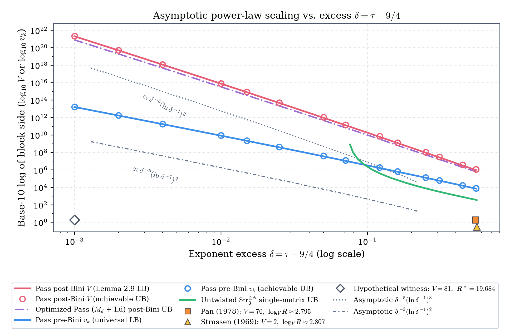

# The Magnitude of the Hidden Constant in Exponent-9/4 Matrix Multiplication

This repository contains the paper [`matmul_9_4_constant.tex`](matmul_9_4_constant.tex), a pure-kernel Lean 4 formalization ([`lean/MatMul94/`](lean/MatMul94/)), and numerical verification ([`verification/`](verification/)).

---

## 1. Overview

On November 24, 2026, OpenAI released the preprint *"The matrix multiplication exponent is nine fourths"*, reporting a matching lower bound $\omega_{\mathbb{F}} = 9/4 = 2.25$ over every field $\mathbb{F}$ to complement the October 2026 upper bound $\omega \le 9/4$. Constructive polynomial-packing proofs (culminating in Pass's explicit Strassen-style construction) realize $\omega \le 9/4$ by producing, for any target exponent $\tau = 9/4 + \delta > 9/4$, an exact rational bilinear identity that multiplies two $V \times V$ matrices using $R < V^\tau$ scalar multiplications, yielding an $O(n^\tau)$ algorithm $T(n) \le C(\tau)\,n^\tau$ by recursive block multiplication.

**Even though every algebraic layer works and composing them proves $\omega \le 9/4$ mathematically, the base block size $v_k \times v_k$ required before the composed recursion even breaks even with classical exponents is astronomical across every valid parameter choice $(c, d, k)$ of Pass's Theorem 4.3:**

- **To beat Strassen ($\tau = 2.800$):** $v_k > 10^{7{,}197}$ universally — attained at $v_k \approx 10^{7{,}928}$ ($6d = 834$ polynomial variables, $k = 114$ rounds).
- **To beat Coppersmith–Winograd ($\tau = 2.371$):** $v_k > 10^{1.67 \times 10^6}$ universally — attained at $v_k \approx 10^{1.77 \times 10^6}$ ($6d = 20{,}352$ polynomial variables, $k = 3{,}769$ rounds).
- **To reach $\tau = 2.251$:** $v_k > 10^{1.62 \times 10^{13}}$ universally — attained at $v_k \approx 10^{1.66 \times 10^{13}}$ ($6d \approx 6.16 \times 10^8$ polynomial variables, $k \approx 1.41 \times 10^8$ rounds).

And those are **before** Bini $\varepsilon$-interpolation inflates the exact base block side exponentially further to $V > 10^{9.51 \times 10^5}$ (at $\tau = 2.800$), $V > 10^{6.15 \times 10^9}$ (at $\tau = 2.371$), and $V > 10^{2.08 \times 10^{21}}$ (at $\tau = 2.251$). **At any matrix size $n$ that fits in real memory, running the composed recursion directly would do vastly more work than naive $O(n^3)$.**

**This paper proves exact, unviolable algebraic lower bounds and matching constructive achievability (upper) bounds on how large $v_k$, $V$, and $C(\tau)$ must be.**

### Figures

#### Figure 1: Universal Lower Bounds and Constructive Achievability vs. Exponent $\tau$


#### Figure 2: Asymptotic Power-Law Scaling vs. Excess $\delta = \tau - 9/4$



### Headline Scaling Laws (Within the Polynomial-Packing Paradigm)

Across **every** valid parameter choice $(c, d, k)$ of Pass's Theorem 4.3 — and across Pass's entire generalized Remark 4.5 meta-family, even with zero balancing loss — no realization can beat:

- **Pre-Bini approximate base block side $v_k$:**
  $$\log_{10} v_k(\delta) \;=\; \Theta\!\Bigl(\delta^{-3}\,(\ln \delta^{-1})^2\Bigr)$$
- **Post-Bini exact base block side $V = v_k^h$ (after removing the formal $\varepsilon$ parameter):**
  $$\log_{10} V(\delta) \;=\; \Theta\!\Bigl(\delta^{-5}\,(\ln \delta^{-1})^3\Bigr)$$
- **Arithmetic hidden constant $C(\tau)$ in $T(n) \le C(\tau)\,n^\tau$:**
  $$C(\tau) \;\ge\; (V - 1)^{3 - \tau} \quad \text{(even with optimal schoolbook fallback below } V\text{)}, \qquad \log_{10} C(\tau) \;=\; \Theta\!\Bigl(\delta^{-5}\,(\ln \delta^{-1})^3\Bigr).$$

### Concrete Numbers Across Benchmark Exponents

The universal lower bounds and constructive upper witnesses agree to within **$2\%$–$23\%$ in the double exponent** across 16 orders of magnitude:

| Target $\tau$ | Meaning | Pre-Bini $\log_{10} v_k$ (LB $\to$ UB) | Post-Bini $\log_{10} V$ (LB $\to$ UB) | Hidden Constant $\log_{10} C_{\mathrm{sb}} >$ |
| :--- | :--- | :---: | :---: | :---: |
| **$2.800$** | Barely beats Strassen (1969) | $7{,}197 \to 7{,}928$ | $9.51 \times 10^{5} \to 1.17 \times 10^{6}$ | $1.90 \times 10^{5}$ |
| **$2.500$** | Beats rectangular slabbing | $1.27 \times 10^{5} \to 1.38 \times 10^{5}$ | $9.31 \times 10^{7} \to 1.05 \times 10^{8}$ | $4.65 \times 10^{7}$ |
| **$2.371$** | Beats Coppersmith–Winograd / AlphaEvolve | $1.67 \times 10^{6} \to 1.77 \times 10^{6}$ | $6.15 \times 10^{9} \to 6.73 \times 10^{9}$ | $3.87 \times 10^{9}$ |
| **$2.321$** | Untwisted $\mathrm{Str}_3$ ceiling | $1.08 \times 10^{7} \to 1.13 \times 10^{7}$ | $1.30 \times 10^{11} \to 1.40 \times 10^{11}$ | $8.85 \times 10^{10}$ |
| **$2.260$** | Within $0.01$ of $9/4$ | $8.44 \times 10^{9} \to 8.72 \times 10^{9}$ | $7.66 \times 10^{15} \to 7.99 \times 10^{15}$ | $5.67 \times 10^{15}$ |
| **$2.251$** | Within $0.001$ of $9/4$ | $1.62 \times 10^{13} \to 1.66 \times 10^{13}$ | $2.08 \times 10^{21} \to 2.15 \times 10^{21}$ | $1.56 \times 10^{21}$ |

### How Much Can Optimizations Cut the Constant?

- **Exact balanced-word counting ($M_d$) + Lü's $(2w - 1)$-point substitution:** Cuts $\log_{10} V$ by **$1.8\times$ to $5.9\times$** (and works over every characteristic), without altering the $\delta^{-5}(\ln\delta^{-1})^3$ scaling.
- **Single-shot untwisting of Strassen's $\mathrm{Str}_3^{\otimes N}$:** Eliminates the $2k$-round degree cascade entirely, dropping the sub-Strassen base block side from $10^{1.17 \times 10^6}$ down to **$10^{23.5}$** (multi-copy direct sum) and **$10^{343.3}$** (single matrix product via finite Schönhage conversion) — but algebraically **stalls at $3\log_6 4 \approx 2.32112$** and cannot approach $9/4$.

### Exact Boundary of Universality (Can *Any* $9/4$ Algorithm Do Better?)

We rigorously separate what is **universally unviolable** from what is **disproved** or **provably open**:

1. **Unviolable across Pass's entire generalized Remark 4.5 meta-family** (even with zero balancing loss $\Delta_{\mathrm{bal}} = 1$): $v_k^{4 a_0} > w^{18 b_0}$ and $d = \Omega(\delta^{-2})$ hold unconditionally (`thm:remark45_universal`).
2. **Unviolable across every border-rank realization obeying $r_0 \ge v_0^{9/4}$:** Any Bini approximate-to-exact conversion at $\varepsilon$-degree $E_\varepsilon$ forces the universal horizon $V > (h E_\varepsilon + 1)^{1/\delta}$ (`prop:general_bini_horizon`).
3. **Disproved for arbitrary bilinear algorithms at $\tau \in (2.32112, 3)$:** Strassen's $2 \times 2$ identity ($V = 2, R = 7$), Pan's $70 \times 70$ algorithm ($V = 70, R = 143{,}640$, $143{,}640^5 < 70^{14}$, $C_{\mathrm{sb}} < 3$), and single-shot untwisted $\mathrm{Str}_3^{\otimes N}$ all strictly beat even Pass's *pre-Bini* universal lower bounds (`thm:disproof_arbitrary`).
4. **Supermultiplicative obstruction for arbitrary algorithms at $\tau \in (9/4, 2.32112)$:** Assuming $\omega \le 9/4$, **every** supermultiplicative rank lower bound (including every point in Strassen's asymptotic spectrum and the asymptotic floor $V^{9/4}$) obeys $\Phi(V) \le V^{9/4}$. Consequently, no such lower bound can rule out polynomial-size identities $(V, R^*) = (\mu^4, \mu^9 + 1)$ with $V = O(\delta^{-4/9})$ — for example, $V = 16, R^* = 513$ at $\tau = 2.251$ satisfies both $513 > 16^{9/4} = 512$ and $513^{1000} < 16^{2251}$ (`thm:supermult_obstruction`).

---

## 2. How the Proof Works: The Five Algebraic Constraints

Every factor in the $\delta^{-5}(\ln\delta^{-1})^3$ explosion comes from a rigid, unavoidable algebraic identity at one of five structural layers:

1. **Layer 1 — Zero-gap smuggling and the cubic rate deficit ($c = \Omega(\delta^{-1})$):**
   - Pure $(c + 1)$-for-$c$ polynomial telescoping achieves **zero net compression** (`prop:pure_telescoping`).
   - Compression $> 1$ requires opening a $b$-wide zero gap ($ct \ge a + 2b - 1$) to smuggle one middle product at order $\varepsilon^1$ (`thm:primal_gap`). Attempting to pack a second payload at $\varepsilon^2$ into the same slot unconditionally collides on an $\varepsilon^{-1}$ pole (`prop:multi_eps_collision`), locking the gain per round to $(c + 2)/c$ against length inflation $\rho(c) = (c + 2)/(c - 1)$.
   - The exact cubic identity $(c + 2)(c - 1)^2 = c^3 - (3c - 2) < c^3$ forces the asymptotic exponent $\tau(c) = \frac{9}{4} + \frac{9}{8c} + O(c^{-2})$ strictly above $9/4$, compelling **$c > \frac{9}{8\delta} - \frac{3}{4c} = \Omega(\delta^{-1})$** (`thm:cubic_rate_floor`).

2. **Layer 2 — Primal-dual balancing in $2d$ variables ($\ln w = \Theta(d \ln c)$):**
   - Iterating rounds requires equal numbers of full and middle polynomial factors. Tensoring $d$ primal and $d$ dual packings produces $M_d(c) = \sum_{h=0}^d \binom{d}{h}^2 (c + 1)^{2(d-h)}$ balanced targets, incurring an unavoidable logarithmic balancing penalty between $(c + 2)^{2d}/(d + 1)$ and $(c + 2)^{2d}/\sqrt{4\pi d/c}$ (`prop:balanced_words`).

3. **Layer 3 — Shared-leg uncoupling ($2w - 1$ copies, $\eta = \varepsilon^w$, factor $64$ per round):**
   - Separating one shared matrix leg across $w$ degree-$(w - 1)$ interpolated blocks produces degree-$(2w - 2)$ polynomials, forcing at least **$2w - 1$ evaluation points** (roughly a factor-$2$ copy overhead) and forcing inner scaling $\eta = \varepsilon^r$ with **$r \ge w$** to prevent negative-power error leakage through the $\varepsilon^{w-1}$ Lagrange denominator (`prop:lagrange_poles`). This pushes the single-leg pole-order sum to $P_1 = (2d + 1)w - 1$.

4. **Layer 4 — Three-leg $S_3$-symmetrization and round amplification ($d = \Omega(\delta^{-2}\ln\delta^{-1})$, $k = \Omega(\delta^{-2}\ln\delta^{-1})$, $\log_{10} v_k = \Theta(\delta^{-3}(\ln\delta^{-1})^2)$):**
   - Independent rectangular slabbing cannot beat $3 - \alpha \ge 7/3 > 9/4$ (`prop:slabbing_barrier`), so all three matrix legs must be coupled via $S_3$-symmetrization across two half-rounds. This cubes and squares the Layer 3 copy factor to **$64 = (2^3)^2$** per round and drives polynomial lengths exponentially as $\rho^k \le 2 L_k - 1 \le \frac{2c}{3}\rho^k$ (`thm:lk_sandwich`).
   - Exact integer cancellation of the cubic deficit yields the logarithm-free universal law **$v_k^{4 a_0} > w^{18 b_0}$** (equivalently $v_k > w^{9/(2\delta)}$) alongside $d = \Omega(c \ln d / \delta) = \Omega(\delta^{-2}\ln\delta^{-1})$ (`thm:universal_round_and_vk`). Because $\ln w = \Theta(d\ln c) = \Theta(\delta^{-2}(\ln\delta^{-1})^2)$, multiplying by $9/(2\delta)$ locks **$\log_{10} v_k = \Theta(\delta^{-3}(\ln\delta^{-1})^2)$**.

5. **Layer 5 — Sequential pole-clearing degree cascade and Bini conversion ($h = \Omega(\delta^{-2}\ln\delta^{-1})$, $\log_{10} V = \Theta(\delta^{-5}(\ln\delta^{-1})^3)$):**
   - Composing $2k$ approximate half-rounds substitutes $\varepsilon \mapsto \varepsilon^S$ with $S = 3(2d + 1)w - 2$ at every half-round, multiplying the output $\varepsilon$-degree exponentially to **$d_\varepsilon^{(2k)} \sim S^{2k}$** (`thm:pole_cascade`; retaining separate parameters $(\varepsilon_1, \dots, \varepsilon_{2k})$ is provably even worse).
   - Removing $\varepsilon$ by Bini interpolation at tensor power $h$ multiplies the rank by $h d_\varepsilon^{(2k)} + 1$, forcing $h > \ln(d_\varepsilon^{(2k)}) / M_k = \Omega(c \ln c / \delta) = \Omega(\delta^{-2}\ln\delta^{-1})$. Raising $v_k$ to the $h$-th power multiplies $\log_{10} v_k$ by $h$, sealing **$\log_{10} V = \Theta(\delta^{-5}(\ln\delta^{-1})^3)$** (`thm:asymptotic_scaling`).

---

## 3. Mechanical Verification (Pure-Kernel Lean 4 + Python)

Every theorem in the paper is independently verified twice:

- **Pure-Kernel Lean 4 (`lean/MatMul94/`, `leanprover/lean4:v4.36.0`):**
  - `7,559` lines across 6 library/root modules plus `AxiomAudit.lean`.
  - **Zero Mathlib / zero external dependencies**, **zero `sorry`**, **zero custom axioms**, **zero `native_decide`**.
  - All `81` exported theorems are verified by `lake env leanchecker --fresh MatMul94` (`EC = 0`) and audited via `#print axioms` strictly within `{propext, Classical.choice, Quot.sound}`.
- **Numerical Verification (`verification/matmul_9_4_constant_check.py`):**
  - `100%` pure Python standard library (exact multivariate polynomial ring `PolyQ` over $\mathbb{Q}$, arbitrary-precision integers, and adversarial mutants on every equation block).
  - Checked for strict backward-only DAG ordering by `verification/dag_check.py`.

---

## 4. Repository Layout

```text
MatMul-9-over-4/
├── matmul_9_4_constant.tex             # Main LaTeX manuscript (with landscape tables at end)
├── matmul_9_4_constant.bib             # Verified BibTeX references
├── figures/
│   ├── bounds_vs_exponent.{pdf,png}    # Figure 1: universal LB & achievability UB vs. tau
│   └── scaling_vs_excess.{pdf,png}     # Figure 2: doubly-log scaling vs. delta = tau - 9/4
├── verification/
│   ├── matmul_9_4_constant_check.py    # 221-check pure-Python symbolic & numerical audit
│   ├── dag_check.py                    # Backward-only DAG & check-file order validator
│   ├── plot_bounds.py                  # Matplotlib generator for Figures 1 and 2
│   └── bib.md                          # Quote-backed bibliography verification log
├── lean/
│   ├── lean-toolchain                  # leanprover/lean4:v4.36.0
│   ├── lakefile.toml                   # Zero-dependency pure-kernel Lean 4 package
│   ├── MatMul94.lean                   # Root import
│   ├── AxiomAudit.lean                 # #print axioms audit across all 81 exported theorems
│   └── MatMul94/
│       ├── Log2Bracket.lean            # Compositional pure-Nat dyadic exponent calculus
│       ├── LayerConstraints.lean       # Layer 1--5 algebraic constraints & Lemma 4.3
│       ├── UniversalBounds.lean        # Infinite-domain universal lower bounds on v_k, V
│       ├── ConstructiveWitnesses.lean  # Machine-checked constructive upper witnesses
│       └── GeneralLimits.lean          # Remark 4.5, Bini horizon, disproof & obstruction
└── README.md                           # This summary
```

### Local Build and Verification

```bash
# 1. Regenerate Figures 1 and 2 (via uv + matplotlib)
uv run verification/plot_bounds.py

# 2. Run the pure-Python symbolic/numerical check suite + DAG validator
python3 -W error verification/matmul_9_4_constant_check.py
python3 verification/dag_check.py matmul_9_4_constant.tex verification/matmul_9_4_constant_check.py

# 3. Cold-build and externally kernel-check the pure Lean 4 formalization
(cd lean && lake clean && lake build && lake env leanchecker --fresh MatMul94 && lake env lean AxiomAudit.lean)

# 4. Build the PDF (cleanly into /tmp/latex-build)
mkdir -p /tmp/latex-build
SRC="$PWD"
pdflatex -file-line-error -synctex=1 -output-directory=/tmp/latex-build matmul_9_4_constant.tex
(cd /tmp/latex-build && BIBINPUTS="$SRC:" bibtex matmul_9_4_constant)
pdflatex -file-line-error -synctex=1 -output-directory=/tmp/latex-build matmul_9_4_constant.tex
pdflatex -file-line-error -synctex=1 -output-directory=/tmp/latex-build matmul_9_4_constant.tex
```
