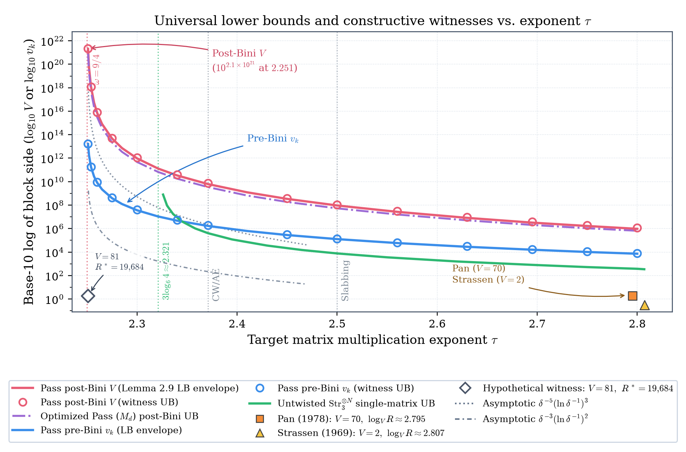

# The Magnitude of the Hidden Constant in Exponent-9/4 Matrix Multiplication

On October 2, 2026, OpenAI proved the non-constructive spectral upper bound ω<sub>ℂ</sub> ≤ 9/4 = 2.25 (*"An Upper Bound of 9/4 for the Matrix Multiplication Exponent"*), and on October 30, 2026 Rafael Pass (*"Matrix Multiplication from Polynomial Packings: A Constructive Proof of ω ≤ 9/4"*, arXiv:2610.28627) eliminated the asymptotic spectrum to give an explicit recursive O(n<sup>9/4 + δ</sup>) integer-arithmetic algorithm for every δ > 0 (Pass's Theorem 1.1). On November 24, 2026, OpenAI released the unrefereed preprint *"The matrix multiplication exponent is nine fourths"*, reporting the matching lower bound ω<sub>𝔽</sub> = 9/4 over every field 𝔽. In a Strassen-style recursive algorithm, the **base block size** is the fixed dimension of the finite bilinear identity applied at each recursive step (splitting each input into a V × V grid of submatrices, analogous to 2 × 2 in Strassen's 7-multiplication algorithm), and its scalar dimension V is the **base block side**. Pass's Theorem 4.3 compiles a five-stage polynomial-packing pipeline over integer parameters (c, d, k) (packing c + 1 full products and one middle product into c slightly longer products, balancing 2d primal-dual variables, uncoupling shared matrix legs, and symmetrizing over k rounds) to produce an approximate bilinear identity of **pre-Bini base block size** v<sub>k</sub> × v<sub>k</sub>; Bini ε-interpolation then removes the formal parameter ε to produce an exact rational bilinear identity of **post-Bini base block size** V × V (V = v<sub>k</sub><sup>h</sup>) and rank R < V<sup>τ</sup> (τ = 9/4 + δ) for recursive block multiplication.

Pass noted qualitatively that the algorithm is "galactic" with enormous hidden constants, without quantifying them. This paper calculates explicit universal lower bounds and matching constructive upper witnesses for those constants ($v_k$, $V$, and the multiplication-count constant $C(\tau)$ in $T(n) \le C(\tau)\,n^\tau$ under specified recursion and fallback rules), together with pure-kernel Lean 4 formalization and numerical verification.

Across every valid parameter choice $(c, d, k)$ of Pass's Theorem 4.3, the pre-Bini base block side $v_k$ required before the composed recursion beats classical exponents is astronomical:

- **Target $\tau = 2.800$ (below Strassen's exponent):** $v_k > 10^{7{,}197}$ universally (with a constructive witness at $v_k \approx 10^{7{,}928}$, $6d = 834$ polynomial variables, $k = 114$ rounds).
- **Target $\tau = 2.371$ (below Coppersmith-Winograd / AlphaEvolve):** $v_k > 10^{1.67 \times 10^6}$ universally (witness at $v_k \approx 10^{1.77 \times 10^6}$, $6d = 20{,}352$ variables, $k = 3{,}769$ rounds).
- **Target $\tau = 2.251$:** $v_k > 10^{1.624 \times 10^{13}}$ universally (witness at $v_k \approx 10^{1.661 \times 10^{13}}$, $6d \approx 6.16 \times 10^8$ variables, $k \approx 1.41 \times 10^8$ rounds).

Under Pass's Lemma 2.9 tracked formal degree budget $S^{2k-1}$, Bini $\varepsilon$-interpolation inflates the post-Bini exact base block side further to $V > 10^{9.504 \times 10^5}$ (at $\tau = 2.800$), $V > 10^{6.149 \times 10^9}$ (at $\tau = 2.371$), and $V > 10^{2.079 \times 10^{21}}$ (at $\tau = 2.251$). Below size $V$, the fixed identity cannot be applied without padding, and falling back to schoolbook multiplication below $V$ saves no multiplications over naive $O(n^3)$.

### Figures

#### Figure 1: Universal Lower Bounds and Constructive Witnesses vs. Exponent $\tau$



#### Figure 2: Asymptotic Power-Law Scaling vs. Excess $\delta = \tau - 9/4$


### Headline Scaling Laws (Polynomial-Packing Framework)

Across **every** valid parameter choice $(c, d, k)$ of Pass's Theorem 4.3 as $\delta = \tau - 9/4 \to 0^+$, the minima over valid parameters obey:

- **Pre-Bini approximate base block side $v_k$:**
  $$\log_{10} v_k(\delta) \;=\; \Theta\!\Bigl(\delta^{-3}\,(\ln \delta^{-1})^2\Bigr)$$
- **Post-Bini exact base block side $V = v_k^h$ (under Pass's Lemma 2.9 tracked degree budget $S^{2k-1}$, with upper witnesses certified under the proved bound $2 S^{2k}$):**
  $$\log_{10} V(\delta) \;=\; \Theta\!\Bigl(\delta^{-5}\,(\ln \delta^{-1})^3\Bigr)$$
- **Least uniform multiplication-count constant $C_{\min}(\tau)$ in $T(n) \le C(\tau)\,n^\tau$:**
  $$C(\tau) \;\ge\; (V - 1)^{3 - \tau} \quad \text{(when the algorithm falls back to schoolbook below } V\text{)}, \qquad \log_{10} C_{\min}(\tau) \;=\; \Theta\!\Bigl(\delta^{-5}\,(\ln \delta^{-1})^3\Bigr)$$
  for unpruned power-of-$V$ recursion (and likewise with schoolbook or padded Strassen fallback below $V$).

For generalized Remark 4.5 iterations satisfying our finite lower-effort and $9/4$-rate hypotheses (`thm:remark45_universal`) with fixed $m_{\mathrm{t}} - n_{\mathrm{s}} > 0$ and $n_{\mathrm{s}} = \Omega(\delta^{-1})$ sources, the pre-Bini bound $\log_{10} v_k(\delta) = \Omega(\delta^{-3}\ln\delta^{-1})$ persists even at zero balancing loss ($\Delta_{\mathrm{bal}} = 1$).

### Concrete Numbers Across Benchmark Exponents

The globally certified universal lower bounds (44-digit outward-rounded interval arithmetic, rounded downward) and exact integer constructive witnesses (rounded $\log_{10}$ sides) agree to within **about $2\%$ to $24\%$ in $\log_{10} v_k$ and $\log_{10} V$** across 16 orders of magnitude:

| Target $\tau$ | Benchmark | Pre-Bini $\log_{10} v_k$ (LB $\to$ UB) | Post-Bini $\log_{10} V$ (Lemma 2.9 LB $\to$ $2S^{2k}$ UB) | Schoolbook $\log_{10} C_{\mathrm{sb}} >$ |
| :--- | :--- | :---: | :---: | :---: |
| **$2.800$** | Below Strassen (1969) | $7{,}197.27 \to 7{,}927.63$ | $9.504 \times 10^{5} \to 1.173 \times 10^{6}$ | $1.900 \times 10^{5}$ |
| **$2.500$** | Below rectangular slabbing | $1.267 \times 10^{5} \to 1.376 \times 10^{5}$ | $9.304 \times 10^{7} \to 1.046 \times 10^{8}$ | $4.652 \times 10^{7}$ |
| **$2.371$** | Below Coppersmith-Winograd / AlphaEvolve | $1.671 \times 10^{6} \to 1.770 \times 10^{6}$ | $6.149 \times 10^{9} \to 6.726 \times 10^{9}$ | $3.868 \times 10^{9}$ |
| **$2.321$** | Below untwisted $\mathrm{Str}_3$ floor | $1.078 \times 10^{7} \to 1.135 \times 10^{7}$ | $1.303 \times 10^{11} \to 1.403 \times 10^{11}$ | $8.852 \times 10^{10}$ |
| **$2.260$** | Within $0.01$ of $9/4$ | $8.439 \times 10^{9} \to 8.719 \times 10^{9}$ | $7.657 \times 10^{15} \to 7.986 \times 10^{15}$ | $5.666 \times 10^{15}$ |
| **$2.251$** | Within $0.001$ of $9/4$ | $1.624 \times 10^{13} \to 1.661 \times 10^{13}$ | $2.079 \times 10^{21} \to 2.145 \times 10^{21}$ | $1.557 \times 10^{21}$ |

### How Much Can Optimizations Cut the Constant?

- **Exact balanced-word counting ($M_d$) + Pass's $(2w - 1)$-point separation:** In Table 4 (certified via explicit integer tuples in 44-digit outward-rounded interval arithmetic), replacing Cauchy-Schwarz $w$ with $M_d$ inside Pass's Lemma 3.4 over $\mathbb{Q}$ cuts $\log_{10} V$ by **$1.81\times$ to $2.78\times$** relative to literal Pass (and **$4.31\times$ to $5.88\times$** relative to OpenAI's $5w$ separation over fields containing a primitive $(5w)$-th root of unity), without altering the $\delta^{-5}(\ln\delta^{-1})^3$ scaling.
- **Single-shot untwisting of Strassen's $\mathrm{Str}_3^{\otimes N}$:** Eliminates the $2k$-half-round degree cascade, dropping the $\tau = 2.800$ base block side from $10^{1.173 \times 10^6}$ down to **$10^{23.5}$** (multi-copy direct sum) and **$10^{375.5}$** (single matrix product via finite Schönhage conversion, $3{,}124\times$ smaller in $\log_{10} V$), but stalls at $3\log_6 4 \approx 2.32112$ and cannot approach $9/4$.

### Exact Boundary of Universality (Can *Any* $9/4$ Algorithm Do Better?)

The bounds depend on which rank certificate or algorithm class is considered:

1. **Conditional across generalized Remark 4.5 iterations (`thm:remark45_universal`):** Under the finite lower-effort and $9/4$-rate hypotheses (a)-(d) with fixed $m_{\mathrm{t}} - n_{\mathrm{s}} > 0$ and $n_{\mathrm{s}} = \Omega(\delta^{-1})$, $v_k^{4 a_0} > w^{18 b_0}$ and $d = \Omega(\delta^{-2})$ hold even with zero balancing loss ($\Delta_{\mathrm{bal}} = 1$).
2. **Full-degree Bini rank certificates achieving target $\tau$ with $r_0 \ge v_0^{9/4}$ (`prop:general_bini_horizon`):** Any full-degree Bini certificate $(h E_\varepsilon + 1) r_0^h < V^\tau$ forces the horizon $V > (h E_\varepsilon + 1)^{1/\delta} \ge (E_\varepsilon + 1)^{1/\delta}$.
3. **Disproved for arbitrary bilinear algorithms on $[2.324, 3)$ and $[2.350, 3)$ (`thm:disproof_arbitrary`):** Strassen's $2 \times 2$ identity ($V = 2, R = 7$), Pan's $70 \times 70$ algorithm ($V = 70, R = 143{,}640$, $143{,}640^5 < 70^{14}$, below-threshold schoolbook ratio $69^{0.2} < 3$), and chains of single-shot untwisted $\mathrm{Str}_3^{\otimes N}$ identities beat Pass's post-Bini lower bounds for every $\tau \in [2.324, 3)$ and Pass's pre-Bini lower bounds for every $\tau \in [2.350, 3)$.
4. **Supermultiplicative obstruction for arbitrary algorithms on $(9/4, 2.324)$ (`thm:supermult_obstruction`):** Assuming $\omega_{\mathbb{F}} \le 9/4$, **every** supermultiplicative rank lower bound (including every point in Strassen's asymptotic spectrum and the asymptotic floor $V^{9/4}$) obeys $\Phi(V) \le V^{9/4}$. No such bound can rule out polynomial-size pairs $(V, R^*) = (\mu^4, \mu^9 + 1)$ with $V = O(\delta^{-4/9})$; for example, $V = 81, R^* = 19{,}684$ at $\tau = 2.251$ satisfies $19{,}684 > 81^{9/4} = 19{,}683 = 3 \cdot 81^2$ and $19{,}684^{1000} < 81^{2251}$ (with below-threshold schoolbook ratio $80^{0.749} < 27$). Non-supermultiplicative bounds exclude only small sizes at $\tau = 2.251$: Bläser's $\frac{5}{2}V^2 - 3V$ excludes $3 \le V \le 33$ (including $V = 16$) over every field, and Massarenti-Raviolo's $\frac{8}{3}V^2 - 7V$ extends this to $3 \le V \le 37$ over $\mathbb{C}$ while giving $16{,}929 < 19{,}684$ at $V = 81$.

---

## Sketch of the Proof: The Five Algebraic Constraints

Each stage of Pass's five-layer construction contributes a concrete algebraic factor to the base block side:

1. **Layer 1: Zero-gap smuggling and the cubic rate deficit ($c = \Omega(\delta^{-1})$).**
   - Pure $(c + 1)$-for-$c$ polynomial telescoping achieves zero net compression (`prop:pure_telescoping`).
   - Compression $> 1$ uses a $b$-wide zero gap ($ct \ge a + 2b - 1$) to smuggle one middle product at order $\varepsilon^1$ (`thm:primal_gap`). Packing a second payload at $\varepsilon^2$ into the same window collides on an $\varepsilon^{-1}$ pole under this decoder (`prop:multi_eps_collision`), giving univariate gain $(c + 2)/c$ against length inflation $\rho(c) = (c + 2)/(c - 1)$.
   - The cubic identity $(c + 2)(c - 1)^2 = c^3 - (3c - 2) < c^3$ places $\tau(c) = \frac{9}{4} + \frac{9}{8c} + O(c^{-2})$ strictly above $9/4$, forcing **$c > \frac{9}{8\delta} - \frac{3}{4\delta c} = \Omega(\delta^{-1})$** (`thm:cubic_rate_floor`).

2. **Layer 2: Primal-dual balancing in $2d$ variables ($\ln w = \Theta(d \ln c)$).**
   - Iterating rounds requires equal numbers of full and middle polynomial factors. Tensoring $d$ primal and $d$ dual packings yields $M_d(c) = \sum_{h=0}^d \binom{d}{h}^2 (c + 1)^{2(d-h)}$ balanced targets, bounded by $(c + 2)^{2d}/(d + 1) \le M_d(c) \le (c + 2)^{2d}$ (`prop:balanced_words`). For fixed $c$ as $d \to \infty$, $M_d(c) = (c + 2)^{2d}/\sqrt{4\pi d p_b(1 - p_b)}\,(1 + O(d^{-1}))$.

3. **Layer 3: Shared-leg uncoupling ($2w - 1$ copies, $\eta = \varepsilon^w$, pole budget $P_1$).**
   - Separating one shared matrix leg across $w$ degree-$(w - 1)$ interpolated blocks produces degree-$(2w - 2)$ polynomials, requiring $2w - 1$ evaluation points for general recovery and using inner scaling $\eta = \varepsilon^w$ to clear the $\varepsilon^{w-1}$ Lagrange denominator (`prop:lagrange_poles`). This sets the single-leg pole-order budget to $P_1 = (2d + 1)w - 1$.

4. **Layer 4: Three-leg $S_3$-symmetrization and round amplification ($d, k = \Omega(\delta^{-2}\ln\delta^{-1})$, $\log_{10} v_k = \Theta(\delta^{-3}(\ln\delta^{-1})^2)$).**
   - Independent rectangular slabbing cannot beat $3 - \alpha \ge 7/3 > 9/4$ (`prop:slabbing_barrier`); Pass couples all three legs via $S_3$-symmetrization across two half-rounds, with round copy multiplier bounded by $64 = (2^3)^2$ and exponential length growth $\rho^k \le 2 L_k - 1 \le \frac{2c}{3}\rho^k$ (`thm:lk_sandwich`).
   - Exact integer cancellation of the cubic deficit gives the logarithm-free universal law **$v_k^{4 a_0} > w^{18 b_0}$** (equivalently $v_k > w^{9/(2\delta)}$) alongside $d = \Omega(c \ln d / \delta) = \Omega(\delta^{-2}\ln\delta^{-1})$ (`thm:universal_round_and_vk`). Because $\ln w = \Omega(\delta^{-2}(\ln\delta^{-1})^2)$ (matched along the constructive parameter sequence), multiplying by $9/(2\delta)$ yields **$\log_{10} v_k = \Theta(\delta^{-3}(\ln\delta^{-1})^2)$**.

5. **Layer 5: Sequential pole-clearing degree budget and Bini conversion ($h = \Omega(\delta^{-2}\ln\delta^{-1})$, $\log_{10} V = \Theta(\delta^{-5}(\ln\delta^{-1})^3)$).**
   - Composing $2k$ approximate half-rounds substitutes $\varepsilon \mapsto \varepsilon^S$ with $S = 3(2d + 1)w - 2$ at every half-round, setting Pass's Lemma 2.9 tracked formal degree budget to $S^{2k-1}$ and proving the output degree upper bound $d_\varepsilon^{(2k)} < 2 S^{2k}$ (`thm:pole_cascade`).
   - Removing $\varepsilon$ by Bini interpolation at tensor power $h$ under the tracked degree budget forces $h > (2k - 1)\ln S / M_k = \Omega(c \ln c / \delta) = \Omega(\delta^{-2}\ln\delta^{-1})$. Raising $v_k$ to the $h$-th power multiplies $\log_{10} v_k$ by $h$, giving **$\log_{10} V = \Theta(\delta^{-5}(\ln\delta^{-1})^3)$** (`thm:asymptotic_scaling`).

---

## Mechanical Verification (Pure-Kernel Lean 4 + Python)

The integer inequalities, recurrences, universal parameter-domain bounds, and selected certificates are formalized in pure-kernel Lean 4, while the symbolic polynomial identities, global branch-and-bound lower bounds, exact Table 2-4 witnesses, and monotonicity chains are checked in Python:

- **Pure-Kernel Lean 4 (`verification/lean/`, `leanprover/lean4:v4.36.0`):**
  - `7,623` lines total: `7,502` lines across five library modules in `verification/lean/MatMul94/`, `14` lines in `MatMul94.lean`, and `107` lines in `AxiomAudit.lean`.
  - **Zero Mathlib / zero external dependencies**, **zero `sorry`**, **zero custom axioms**, **zero `native_decide`**.
  - All `85` named headline theorems in `AxiomAudit.lean` are verified by `lake env leanchecker --fresh MatMul94` (`EC = 0`) and audited via `#print axioms` strictly within `{propext, Classical.choice, Quot.sound}`.
  - Analytic asymptotics (Prop. 3.5 local CLT, Thm. 4.2), the realized-degree upper bound in Thm. 3.10(ii), polynomial-interpolation necessity in Prop. 3.6, and tensor-level bilinear constructions are proved in the text rather than formalized in Lean; neither the text nor Lean proves that the top-degree terms of the realized output tensor survive. See Table 5 for the per-result formalization scope.
- **Numerical Verification (`verification/matmul_9_4_constant_check.py`):**
  - Pure Python standard library: exact multivariate polynomial ring `PolyQ` over $\mathbb{Q}$, arbitrary-precision integer checks, 44-digit outward-rounded decimal interval global branch-and-bound certification of Tables 2-3 and the Theorem 4.6 monotonicity chains, 44-digit interval witness and display-rounding checks for Tables 2-4 (including exact $M_d$ enclosures and OpenAI $5w$ tuples), an exact small Lemma 4.3 recurrence test, and adversarial negative-control mutants on every equation block.
  - Checked for strict backward-only DAG ordering and exact equation-label/line synchronization by `verification/dag_check.py`.

### Repo Layout

```text
MatMul-9-over-4/
├── matmul_9_4_constant.tex             # LaTeX manuscript
├── matmul_9_4_constant.bib             # Verified BibTeX references
├── figures/
│   ├── bounds_vs_exponent.{pdf,png}    # Figure 1: universal LB & witnesses vs. tau
│   └── scaling_vs_excess.{pdf,png}     # Figure 2: doubly-log scaling vs. delta = tau - 9/4
├── verification/
│   ├── matmul_9_4_constant_check.py        # Pure-Python symbolic, global-LB & numerical audit
│   ├── dag_check.py                        # Backward-only DAG & label/line validator
│   ├── plot_bounds.py                      # Matplotlib generator for Figures 1 and 2
│   ├── bib.md                              # Primary-source bibliography verification log
│   └── lean/
│       ├── lean-toolchain                  # leanprover/lean4:v4.36.0
│       ├── lakefile.toml                   # Zero-dependency pure-kernel Lean 4 package
│       ├── MatMul94.lean                   # Root import
│       ├── AxiomAudit.lean                 # Axioms audit across 85 named headline theorems
│       └── MatMul94/
│           ├── Log2Bracket.lean            # Compositional pure-Nat dyadic exponent calculus
│           ├── LayerConstraints.lean       # Layer 1--5 algebraic constraints & Lemma 4.3
│           ├── UniversalBounds.lean        # Infinite-domain universal lower bounds on v_k, V
│           ├── ConstructiveWitnesses.lean  # Machine-checked constructive upper witnesses
│           └── GeneralLimits.lean          # Remark 4.5, Bini horizon, disproof & obstruction
└── README.md                               # This summary
```

### Local Build and Verification

```bash
# 1. Regenerate Figures 1 and 2 (via uv + matplotlib)
uv run verification/plot_bounds.py

# 2. Run the pure-Python symbolic/numerical check suite + DAG validator
python3 -W error verification/matmul_9_4_constant_check.py
python3 verification/dag_check.py matmul_9_4_constant.tex \
        verification/matmul_9_4_constant_check.py

# 3. Cold-build and externally kernel-check the pure Lean 4 formalization
(cd verification/lean && lake clean && lake build && lake env leanchecker --fresh MatMul94 && \
        lake env lean AxiomAudit.lean)
```
